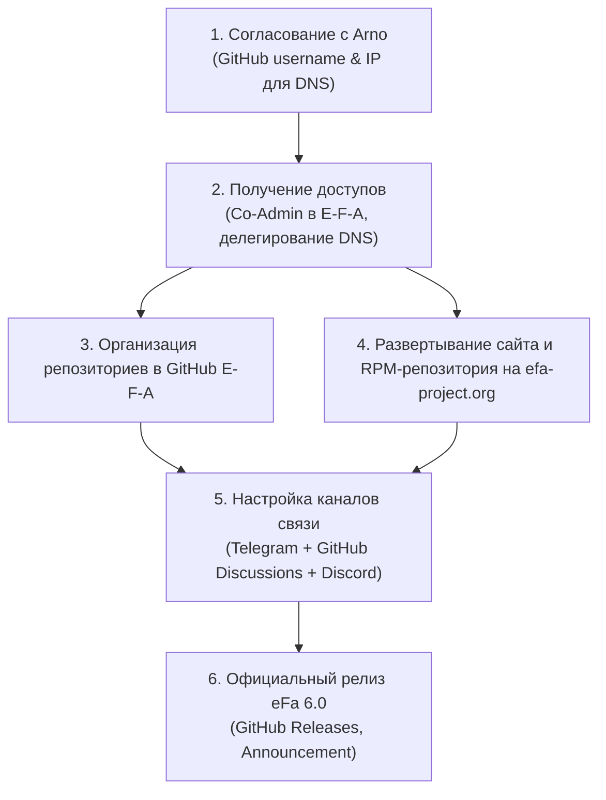

# План перехода и официального перезапуска проекта eFa (E-F-A & efa-project.org)

## 1. Контекст и предыстория
Создатель оригинального проекта eFa (**Arno**) предложил передать официальное руководство проектом:
- Сделать **Yuri (Kit)** ко-админом/владельцем в официальной организации GitHub: [github.com/E-F-A](https://github.com/E-F-A).
- Перенести сайт на официальный домен: **`efa-project.org`** (путём направления DNS на сервер EFA-NG).
- Закрыть устаревший, заспамленный форум phpBB и перевести сообщество на современные платформы (Telegram, Discord, GitHub Discussions).

Это превращает проект из стороннего форка в **официальное, легитимное продолжение проекта eFa**.

---

## 2. Схема перехода



---

## 3. Детальный план действий по этапам

### Этап 1. Доступы и согласование
1. **GitHub Access:**
   - Предоставить Арно имя пользователя: `kit400`.
   - Получить права Owner / Co-admin в организации [https://github.com/E-F-A](https://github.com/E-F-A).
2. **DNS и веб-хостинг (выбор в пользу делегирования DNS):**
   - Не брать на баланс старый устаревший сервер eFa (во избежание унаследованных дыр безопасности и чужого легаси).
   - Запросить у Арно направление A-записей на наш чистый сервер:
     - `efa-project.org`
     - `www.efa-project.org`
     - `repo.efa-project.org`
3. **Форум phpBB:**
   - Подтвердить закрытие phpBB. На его месте разместить информационную страницу со ссылками на новые каналы.

---

### Этап 2. Миграция и структура репозиториев на GitHub
1. **Аудит организации `E-F-A`:**
   - Перевести старые репозитории (`eFa4`, `v4` и др.) в статус **Archive (Read-Only)** с пометкой в README: *"Legacy branch for CentOS 7 / eFa v4. For current versions, see eFa-NG."*
2. **Перенос кодовой базы EFA-NG:**
   - Перенести `kit400/EFA-NG` в организацию `E-F-A` (как `E-F-A/eFa` или `E-F-A/eFa-NG`).
   - Перенести модернизированный `kit400/MailWatch-NG` в `E-F-A/MailWatch` (со всеми тестами PHPUnit, PHPStan, PHP 8.4 и закрытыми CVE).
3. **Подключение GitHub Discussions:**
   - Включить вкладку **Discussions** в репозитории `E-F-A/eFa` для структурированных вопросов, предложений и решения проблем (встроенная защита GitHub от спамеров).

---

### Этап 3. Сайт и инфраструктура RPM-репозиториев
1. **Веб-сервер `efa-project.org`:**
   - Развернуть чистый стек (Nginx/Apache + Let's Encrypt SSL).
   - Опубликовать современный адаптивный лендинг:
     - О проекте eFa v6 (Enterprise Linux 10, PHP 8.4, Perl 5.40, нативный NFTables).
     - Команда быстрой установки в одну строку: `curl -sSL https://efa-project.org/install.bash | bash`.
     - Официальный переход сообщества в Telegram и GitHub Discussions.
2. **Репозиторий пакетов `repo.efa-project.org`:**
   - Настроить зеркало для CentOS Stream 10 / RHEL 10.
   - Обеспечить раздачу подписанных RPM-пакетов (`repomd.xml.asc`, `RPM-GPG-KEY-EFA-PROJECT`).

---

### Этап 4. Каналы сообщества и поддержка
1. **Telegram:** Основная оперативная площадка ([https://t.me/EFA_NG](https://t.me/EFA_NG)).
2. **GitHub Discussions:** База знаний, Q&A, багрепорты и обсуждение новых фич.
3. **Discord:** Опционально для международных пользователей.

---

### Этап 5. Официальный релиз eFa 6.0
1. Опубликовать релиз `eFa 6.0` в GitHub Releases `E-F-A/eFa`.
2. Опубликовать ChangeLog со списком всех исправлений безопасности и модернизации.
3. Направить уведомление Арно и сообществу.

---

## 4. Проект письма Арно (Draft Reply)

### English (для отправки)
```text
Subject: Re: eFa Project & EFA-NG continuation

Hi Arno,

This is fantastic news, and I gladly accept your suggestion! 

Using the official GitHub organization and efa-project.org domain is by far the best way forward. It gives existing users complete confidence that the project is officially alive and in good hands, rather than just an external fork.

Here is how we can smoothly organize the transition:

1. GitHub Access:
   My GitHub username is: kit400 (https://github.com/kit400)
   Whenever you have a moment, please add me as a co-admin/owner to the E-F-A organization (https://github.com/E-F-A). Once added, I will archive the legacy v4 repositories for historical reference and bring over the modernized EL10 codebase and MailWatch fixes.

2. Domain & Web Hosting (DNS):
   I completely agree that pointing the DNS to our new server is the cleanest and safest solution. It avoids inheriting old server maintenance or dealing with legacy software. 
   When you're ready, here are the DNS records to point to our infrastructure:
   - efa-project.org (A record) -> 212.1.66.160
   - www.efa-project.org (A / CNAME record) -> 212.1.66.160
   - repo.efa-project.org (A / CNAME record) -> 212.1.66.160
   (We will handle Let's Encrypt SSL certificates, modern Nginx/Apache configuration, and GPG-signed RPM repository mirrors on this end).

3. Community & Forums:
   Retiring the phpBB forum is 100% the right call. The spam problem on phpBB is endless. Instead, we can:
   - Enable GitHub Discussions under the main repository (GitHub handles spam filtering seamlessly).
   - Use our active Telegram community (https://t.me/EFA_NG) and set up a Discord server for real-time discussion.
   - Put a clear note on the website explaining that forums have moved to GitHub Discussions / Telegram / Discord.

Thank you so much for your trust, Arno. I'm excited to carry the project forward under its rightful home!

Best regards,

Yuri (Kit)  
GitHub: @kit400
```

### Русский перевод (для проверки)
```text
Тема: Re: eFa Project & EFA-NG continuation

Привет, Арно,

Это фантастическая новость, и я с радостью принимаю твоё предложение!

Использование официальной организации на GitHub и домена efa-project.org — наилучший путь. Это дает пользователям полную уверенность, что проект официально жив и развивается в надежных руках, а не является сторонним форком.

Вот как мы можем плавно организовать переход:

1. Доступ к GitHub:
   Мой профиль GitHub: kit400 (https://github.com/kit400)
   Когда будет возможность, добавь меня ко-админом/владельцем в организацию E-F-A (https://github.com/E-F-A). После добавления я переведу старые репозитории v4 в архив для истории и перенесу модернизированную кодовую базу для EL10 и исправления MailWatch.

2. Домен и хостинг (DNS):
   Я полностью согласен, что перенаправление DNS на наш новый сервер — самое чистое и безопасное решение. Это избавит от необходимости обслуживать старый сервер или разбираться с устаревшим софтом.
   Когда будешь готов, вот записи DNS для перенаправления:
   - efa-project.org (A) -> 212.1.66.160
   - www.efa-project.org (A / CNAME) -> 212.1.66.160
   - repo.efa-project.org (A / CNAME) -> 212.1.66.160
   (Мы сами настроим SSL-сертификаты Let's Encrypt, современный веб-сервер и зеркало GPG-подписанного RPM-репозитория).

3. Сообщество и форумы:
   Закрытие phpBB — на 100% правильное решение. Проблема спама на phpBB бесконечна. Вместо этого мы можем:
   - Включить GitHub Discussions в основном репозитории (GitHub отлично фильтрует спам сам).
   - Использовать наше активное сообщество в Telegram (https://t.me/EFA_NG) и запустить сервер в Discord для оперативного общения.
   - Разместить на сайте понятное уведомление о переносе форумов в GitHub Discussions / Telegram / Discord.

Огромное спасибо за доверие, Арно. Я очень рад продолжить развитие проекта в его родном доме!

С наилучшими пожеланиями,  
Юрий (Kit)  
GitHub: @kit400
```
